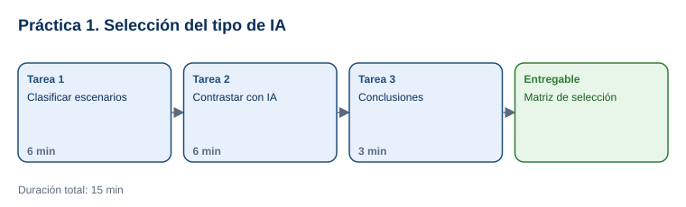

# Práctica 1. Selección de tipo de IA según el problema

**Taller práctico: Aplicación de la Inteligencia Artificial Moderna · Práctica 1 de 7**

⏱️ **Duración:** 15 min · 🛠️ **Herramienta:** ChatGPT o Microsoft Copilot (versión web) · 📄 **Entregable:** `Seleccion_Tipo_IA_[INICIALES].xlsx`

## Descripción

Antes de usar inteligencia artificial hay que elegir el tipo adecuado: no se resuelve igual un problema de texto que uno de imágenes o uno de predicción. En esta práctica el participante analizará 8 escenarios de negocio, decidirá si conviene procesamiento de lenguaje natural (NLP), visión artificial o un modelo predictivo de aprendizaje automático (ML) y justificará su elección. Después contrastará sus respuestas con una herramienta de IA generativa y corregirá lo necesario.

## Objetivos de aprendizaje

Al finalizar la práctica, el participante será capaz de:

- Clasificar un problema según el tipo de dato principal: texto, imagen o datos históricos para predecir.
- Relacionar cada problema con el tipo de IA adecuado (NLP, visión artificial o ML predictivo) y una técnica típica.
- Validar y ajustar su decisión contrastándola con una herramienta de IA.



## Antes de empezar

| Elemento | Valor |
|---|---|
| Dónde trabajar | Navegador web: [chatgpt.com](https://chatgpt.com/) o [copilot.microsoft.com](https://copilot.microsoft.com/) |
| Archivos de la práctica | [Casos_Practicos_Tipo_IA.xlsx](recursos/Casos_Practicos_Tipo_IA.xlsx) |
| Carpeta de trabajo | `Documentos\Taller_IA_Moderna\Practica01\` |
| Regla rápida | Texto → NLP · Imagen o video → Visión artificial · Datos históricos para estimar o anticipar → ML predictivo |
| Nombre del entregable | `Seleccion_Tipo_IA_[INICIALES].xlsx` |

> La hoja `Clave_instructor` contiene las respuestas: no abrirla hasta terminar la Tarea 2.

---

## Tarea 1. Clasificar los escenarios (6 min)

**Objetivo:** Tener los 8 escenarios con su tipo de IA y justificación.

**Por qué:** Elegir mal el tipo de IA lleva a soluciones caras que no resuelven el problema.

**Paso 1.** Descargar `Casos_Practicos_Tipo_IA.xlsx` en la carpeta de trabajo y guardarlo como `Seleccion_Tipo_IA_[INICIALES].xlsx`.

**Paso 2.** En la hoja `Escenarios`, leer cada escenario y elegir en la columna **Mi elección** NLP, Visión artificial o ML predictivo.

**Paso 3.** Escribir en **Mi justificación** una frase que indique el tipo de dato y lo que se quiere obtener. Ejemplo para C1: *"Son comentarios de texto que hay que clasificar por intención"*.

**Al terminar esta tarea debes tener:**

- ✔ Los 8 escenarios clasificados y justificados.

---

## Tarea 2. Contrastar con una herramienta de IA (6 min)

**Objetivo:** Registrar la respuesta de la IA y si coincide con la suya.

**Por qué:** Contrastar con otra fuente revela supuestos y casos con más de una respuesta válida.

**Paso 1.** Abrir ChatGPT o Copilot e iniciar una conversación nueva.

**Paso 2.** Copiar las columnas **ID** y **Escenario** de la hoja (celdas A1:B9), pegarlas al final del siguiente prompt y enviarlo:

```text
Eres consultor de inteligencia artificial. Para cada escenario indica:
1) El tipo de IA más adecuado: NLP, visión artificial o ML predictivo.
2) La técnica típica (por ejemplo, clasificación de texto, OCR, regresión).
3) Una justificación de una línea basada en el tipo de dato.
Responde en una tabla con columnas: ID | Tipo de IA | Técnica | Justificación.

[PEGAR AQUÍ LOS ESCENARIOS]
```

**Paso 3.** Copiar el tipo de IA de cada fila en la columna **Respuesta de la IA** y marcar **¿Coincide?** con Sí o No.

**Paso 4.** Para cada "No", escribir en **Ajuste después de contrastar** qué decisión mantiene y por qué.

**Al terminar esta tarea debes tener:**

- ✔ Las respuestas de la IA registradas y los desacuerdos analizados.

---

## Tarea 3. Conclusiones (3 min)

**Objetivo:** Comparar con la clave y guardar el entregable.

**Por qué:** Algunos escenarios combinan tipos de IA; reconocerlo es parte de diseñar una solución real.

**Paso 1.** Abrir la hoja `Clave_instructor` y comparar.

**Paso 2.** Comentar en grupo: C6 (facturas escaneadas) usa visión artificial (OCR) para obtener el texto y luego puede usar NLP para interpretarlo; ¿qué otro escenario combinaría dos tipos de IA?

**Paso 3.** Guardar el archivo.

**Al terminar esta tarea debes tener:**

- ✔ El archivo guardado con al menos 6 de 8 coincidencias con la clave o con la diferencia justificada.

---

## Validación y pruebas

| Caso | Escenario | Respuesta esperada |
|---|---|---|
| Texto | C1, C4, C7 | NLP (clasificación, resumen, traducción) |
| Imagen | C2, C6 | Visión artificial (detección de objetos, OCR) |
| Predicción | C3, C5, C8 | ML predictivo (series de tiempo, anomalías, clasificación) |
| Caso adversarial | Pedir a la IA: *"Usa visión artificial para predecir las ventas de la próxima semana"* | La IA debe explicar que el problema es de datos históricos (ML predictivo), no de imágenes |

## Entregables

| Entregable | Contenido | Criterio de verificación |
|---|---|---|
| `Seleccion_Tipo_IA_[INICIALES].xlsx` | Hoja `Escenarios` completa | 8 escenarios con elección, justificación, respuesta de la IA, coincidencia y ajuste |

## Resultado esperado

- El participante identifica el tipo de IA adecuado a partir del tipo de dato y del resultado buscado.
- Usa la IA como apoyo para validar, sin aceptar su respuesta sin análisis.

## Solución de problemas

**La herramienta no devuelve una tabla**
- *Síntoma:* respuesta en párrafos.
- *Causa:* el formato no quedó claro.
- *Solución:* escribir *"Responde solo con la tabla"*.

**La IA propone un tipo distinto que también parece válido**
- *Síntoma:* desacuerdo en un escenario.
- *Causa:* algunos problemas admiten más de un enfoque.
- *Solución:* registrar ambos y justificar cuál conviene según el objetivo del escenario.

## Limpieza

- Conservar el entregable en `Documentos\Taller_IA_Moderna\Practica01\`.

## Recursos opcionales

- [Google: Machine Learning Glossary](https://developers.google.com/machine-learning/glossary)

<sub>Complejidad: Fácil · Nivel de Bloom: Analizar</sub>

---

[Inicio](../README.md) | [Siguiente: Práctica 2 ➡](../Capitulo02/README.md)
