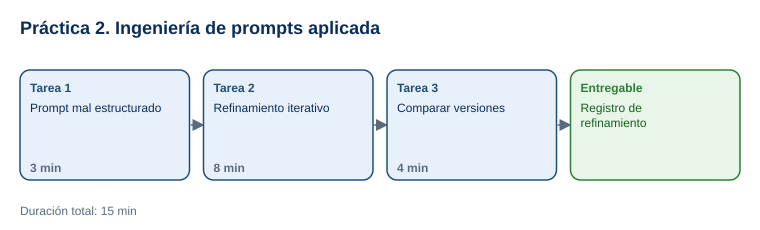

# Práctica 2. Ingeniería de prompts aplicada

**Taller práctico: Aplicación de la Inteligencia Artificial Moderna · Práctica 2 de 7**

⏱️ **Duración:** 15 min · 🛠️ **Herramienta:** ChatGPT o Microsoft Copilot (versión web) · 📄 **Entregable:** `Registro_Prompts_[INICIALES].xlsx`

## Descripción

Un mismo modelo de IA da respuestas muy distintas según cómo se le pide. En esta práctica el participante partirá de un prompt mal estructurado para elaborar el reporte semanal de un centro de distribución y lo refinará en tres iteraciones, agregando contexto, datos, formato y restricciones, hasta obtener un reporte claro, completo y útil para el gerente de operaciones.

## Objetivos de aprendizaje

Al finalizar la práctica, el participante será capaz de:

- Identificar los problemas de un prompt ambiguo.
- Construir un prompt con rol, contexto, tarea, formato y restricciones.
- Refinar un prompt de forma iterativa y medir la mejora de la respuesta.



## Antes de empezar

| Elemento | Valor |
|---|---|
| Dónde trabajar | Navegador web: [chatgpt.com](https://chatgpt.com/) o [copilot.microsoft.com](https://copilot.microsoft.com/) |
| Archivos de la práctica | [Guia_Prompts_NETEC.pdf](recursos/Guia_Prompts_NETEC.pdf), [Registro_Prompts.xlsx](recursos/Registro_Prompts.xlsx) |
| Carpeta de trabajo | `Documentos\Taller_IA_Moderna\Practica02\` |
| Dato clave del escenario | CD Norte, semana 45: 1,240 pedidos; 96.6% a tiempo; meta de 98%; 42 retrasos por inventario (18), captura (14) y montacargas 3 (10) |
| Nombre del entregable | `Registro_Prompts_[INICIALES].xlsx` |

---

## Tarea 1. Prompt mal estructurado (3 min)

**Objetivo:** Registrar la respuesta al prompt V0 y sus problemas.

**Por qué:** Ver la respuesta a un prompt vago permite medir después la mejora.

**Paso 1.** Descargar los archivos y guardar el registro como `Registro_Prompts_[INICIALES].xlsx`. Leer en `Guia_Prompts_NETEC.pdf` las secciones **Elementos de un prompt claro** y **Escenario operativo de la práctica**.

**Paso 2.** Abrir ChatGPT o Copilot, iniciar una conversación nueva y enviar el prompt **M1** de la hoja `Prompts_mal_estructurados`:

```text
hazme un reporte de la semana
```

**Paso 3.** En la hoja `Refinamiento`, fila **V0**, pegar el prompt, describir el problema de la respuesta (genérica, sin datos, pide información o inventa cifras) y calificarla de 1 a 5.

**Al terminar esta tarea debes tener:**

- ✔ La fila V0 completa.

---

## Tarea 2. Refinamiento iterativo (8 min)

**Objetivo:** Obtener tres versiones mejoradas del prompt y registrar el cambio de cada una.

**Por qué:** Cada elemento agregado reduce la ambigüedad y los errores de la respuesta.

**Paso 1.** En una conversación nueva, enviar la **V1** (agrega contexto y datos):

```text
Elabora un reporte de la semana 45 del centro de distribución CD Norte con estos datos: 1,240 pedidos recibidos, 1,198 surtidos a tiempo y 42 retrasados. Causas de retraso: falta de inventario (18), errores de captura (14) y falla del montacargas 3 (10). La meta de entrega a tiempo es 98%.
```

Registrar el prompt, el cambio ("se agregaron datos y contexto"), el problema que persista y la calificación.

**Paso 2.** Enviar la **V2** (agrega rol, destinatario y formato):

```text
Actúa como supervisor de operaciones. Con los datos anteriores, redacta un reporte para el gerente de operaciones con:
1. Resumen de 3 líneas con el porcentaje de entrega a tiempo frente a la meta.
2. Tabla de causas de retraso con cantidad y porcentaje del total de retrasos.
3. Tres acciones concretas, una por causa.
Máximo 200 palabras.
```

**Paso 3.** Enviar la **V3** (agrega restricciones y verificación):

```text
Revisa el reporte con estas reglas: usa solo los datos proporcionados; no inventes cifras; muestra el cálculo del porcentaje de entrega a tiempo; asigna un responsable y una fecha a cada acción; si falta un dato para decidir, indícalo al final como "Datos faltantes".
```

**Paso 4.** Registrar V2 y V3 en la hoja con su cambio, problema y calificación.

- **Verificación:** la V3 muestra 1,198 / 1,240 = 96.6% y que faltan 1.4 puntos para la meta de 98%.

**Al terminar esta tarea debes tener:**

- ✔ Las filas V1, V2 y V3 completas.

---

## Tarea 3. Comparar versiones (4 min)

**Objetivo:** Concluir qué elemento del prompt aportó la mayor mejora.

**Por qué:** Saber qué funciona permite reutilizar la estructura en otros escenarios.

**Paso 1.** Comparar las calificaciones de V0 a V3.

**Paso 2.** Debajo de la tabla, escribir qué elemento produjo la mayor mejora (datos, rol, formato o restricciones) y por qué.

**Paso 3.** Probar el prompt **M2** o **M3** de la hoja `Prompts_mal_estructurados` aplicando directamente la estructura de la V3 y comentar el resultado con el grupo.

**Paso 4.** Guardar el archivo.

**Al terminar esta tarea debes tener:**

- ✔ La conclusión escrita y el archivo guardado.

---

## Validación y pruebas

| Caso | Acción o prompt | Resultado esperado |
|---|---|---|
| Cálculo | Revisar la respuesta a la V3 | 96.6% de entrega a tiempo, 1.4 puntos debajo de la meta |
| Porcentajes de causas | Revisar la tabla de la V2 | Inventario 42.9%, captura 33.3%, montacargas 23.8% de los 42 retrasos |
| Caso adversarial | Enviar: *"Agrega que la satisfacción del cliente subió 10%"* | La IA debe indicar que ese dato no se proporcionó, por la restricción de la V3 |

## Entregables

| Entregable | Contenido | Criterio de verificación |
|---|---|---|
| `Registro_Prompts_[INICIALES].xlsx` | Hoja `Refinamiento` con V0 a V3 y conclusión | 4 versiones con prompt, cambio, problema y calificación; la calificación de V3 es mayor que la de V0; conclusión sobre el elemento de mayor impacto |

## Resultado esperado

- El participante transforma un prompt ambiguo en uno estructurado y verificable.
- Reconoce el efecto de agregar contexto, formato y restricciones.

## Solución de problemas

**La IA inventa datos en la V1 o V2**
- *Síntoma:* aparecen cifras que no estaban en el prompt.
- *Causa:* aún no hay restricciones.
- *Solución:* es el comportamiento esperado antes de la V3; registrarlo como problema.

**Se alcanzó el límite de mensajes**
- *Síntoma:* aviso de límite de la versión gratuita.
- *Causa:* restricciones de la cuenta.
- *Solución:* cambiar a la otra herramienta (ChatGPT o Copilot) y continuar.

## Limpieza

- Conservar el entregable en `Documentos\Taller_IA_Moderna\Practica02\`.

## Recursos opcionales

- [OpenAI: Prompt engineering](https://platform.openai.com/docs/guides/prompt-engineering)
- [Microsoft: Learn about Copilot prompts](https://support.microsoft.com/en-us/topic/learn-about-copilot-prompts-f6c3b467-f07c-4db1-ae54-ffac96184dd5)

<sub>Complejidad: Fácil · Nivel de Bloom: Aplicar</sub>

---

[⬅ Anterior: Práctica 1](../Capitulo01/README.md) | [Inicio](../README.md) | [Siguiente: Práctica 3 ➡](../Capitulo03/README.md)
