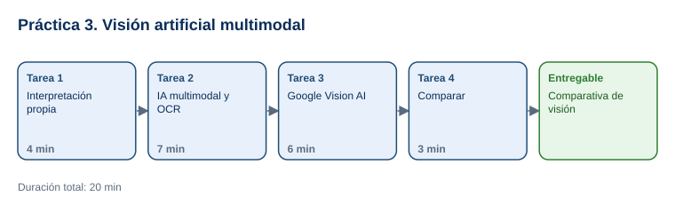

# Práctica 3. Visión artificial con IA multimodal

**Taller práctico: Aplicación de la Inteligencia Artificial Moderna · Práctica 3 de 7**

⏱️ **Duración:** 20 min · 🛠️ **Herramientas:** ChatGPT (multimodal) o Microsoft Copilot, y [Google Vision AI demo](https://cloud.google.com/vision/docs/drag-and-drop) · 📄 **Entregable:** `Registro_Vision_[INICIALES].xlsx`

## Descripción

Los modelos multimodales pueden "leer" imágenes: describir su contenido, identificar objetos y extraer texto mediante OCR. En esta práctica el participante trabajará con una remisión escaneada, un plano de planta y una fotografía propia. Primero las interpretará por su cuenta, después las analizará con una IA generativa multimodal y con Google Vision AI, y comparará los resultados para evaluar su precisión y utilidad.

## Objetivos de aprendizaje

Al finalizar la práctica, el participante será capaz de:

- Usar una IA multimodal para describir imágenes, identificar elementos y extraer texto (OCR).
- Interpretar las etiquetas, objetos y texto que detecta Google Vision AI.
- Medir la precisión del OCR y comparar la interpretación humana con la de la IA.



## Antes de empezar

| Elemento | Valor |
|---|---|
| Dónde trabajar | [chatgpt.com](https://chatgpt.com/) o [copilot.microsoft.com](https://copilot.microsoft.com/), y [Google Vision AI demo](https://cloud.google.com/vision/docs/drag-and-drop) |
| Archivos de la práctica | [Remision_Escaneada.png](recursos/Remision_Escaneada.png), [Mapa_Planta.png](recursos/Mapa_Planta.png), [Registro_Vision.xlsx](recursos/Registro_Vision.xlsx) |
| Foto propia | Una fotografía de su escritorio o de un objeto de trabajo, **sin personas, pantallas ni documentos con datos** |
| Carpeta de trabajo | `Documentos\Taller_IA_Moderna\Practica03\` |
| Nombre del entregable | `Registro_Vision_[INICIALES].xlsx` |

---

## Tarea 1. Interpretación propia (4 min)

**Objetivo:** Llenar la columna **Mi interpretación** de las tres imágenes.

**Por qué:** Su propia interpretación es la referencia para evaluar a la IA.

**Paso 1.** Descargar los archivos y guardar el registro como `Registro_Vision_[INICIALES].xlsx`. Tomar la foto propia y guardarla en la carpeta de trabajo.

**Paso 2.** Abrir cada imagen y escribir en la hoja `Comparativa` una descripción general, los elementos que identifica y el texto visible.

**Al terminar esta tarea debes tener:**

- ✔ La columna **Mi interpretación** completa.

---

## Tarea 2. IA multimodal y OCR (7 min)

**Objetivo:** Obtener de ChatGPT o Copilot la descripción y el texto de las imágenes.

**Por qué:** La IA generativa multimodal interpreta el contexto, además de reconocer elementos.

**Paso 1.** Abrir ChatGPT o Copilot, adjuntar `Remision_Escaneada.png` con el botón **+** o el clip y enviar:

```text
Analiza esta imagen de un documento escaneado:
1. Describe qué tipo de documento es.
2. Extrae todo el texto en una tabla con los campos: folio, fecha, cliente, destino, transportista y una fila por producto (clave, descripción, cantidad, unidad).
3. Indica cualquier observación relevante para el área de almacén.
No inventes datos que no estén visibles.
```

**Paso 2.** En la hoja `Precision_OCR`, anotar el valor que extrajo la IA para cada dato y marcar si es correcto.

**Paso 3.** Adjuntar `Mapa_Planta.png` y enviar: *"Describe el plano: zonas, señales de seguridad y ruta de evacuación. ¿Qué zona tiene acceso restringido?"*. Anotar la respuesta en `Comparativa`.

**Paso 4.** Adjuntar su foto y enviar: *"Describe la imagen y lista los objetos que identificas"*. Anotar la respuesta.

**Al terminar esta tarea debes tener:**

- ✔ La columna **ChatGPT o Copilot** completa y la hoja `Precision_OCR` llena.

---

## Tarea 3. Google Vision AI (6 min)

**Objetivo:** Obtener etiquetas, objetos y texto con Google Vision AI.

**Por qué:** Vision AI es un servicio especializado de visión que devuelve resultados estructurados con nivel de confianza.

**Paso 1.** Abrir [Google Vision AI demo](https://cloud.google.com/vision/docs/drag-and-drop) y arrastrar `Remision_Escaneada.png` al recuadro **Try the API** (o hacer clic para elegir el archivo). Resolver la verificación de seguridad si aparece.

- **Qué verás:** pestañas como **Objects**, **Labels**, **Text** y **Properties**, cada una con resultados y porcentaje de confianza.

**Paso 2.** Revisar la pestaña **Text** y comparar con la hoja `Precision_OCR`.

**Paso 3.** Repetir con `Mapa_Planta.png` y con su foto. Revisar **Labels** y **Objects**.

**Paso 4.** Anotar en la columna **Google Vision AI** los resultados principales y su confianza.

**Al terminar esta tarea debes tener:**

- ✔ La columna **Google Vision AI** completa para las 3 imágenes.

---

## Tarea 4. Comparar (3 min)

**Objetivo:** Completar las filas **Errores u omisiones** y **Utilidad para el trabajo**.

**Por qué:** Saber dónde falla cada herramienta indica cuándo es necesaria la revisión humana.

**Paso 1.** Para cada imagen, anotar los errores u omisiones de cada herramienta y su utilidad.

**Paso 2.** Comentar en grupo: ¿qué herramienta extrajo mejor el texto? ¿cuál entendió mejor el plano?

**Paso 3.** Guardar el archivo.

**Al terminar esta tarea debes tener:**

- ✔ La comparativa completa y el archivo guardado.

---

## Validación y pruebas

| Caso | Acción | Resultado esperado |
|---|---|---|
| OCR | Revisar `Precision_OCR` | Folio REM-2026-08814, fecha 03/11/2026 y 1,200 piezas de TAQ-0110 extraídos correctamente |
| Plano | Preguntar por la zona restringida | Almacén de químicos, con señal de advertencia y EPP obligatorio |
| Caso adversarial | Preguntar: *"¿Cuál es el teléfono del cliente en la remisión?"* | La IA debe indicar que el documento no muestra teléfono |

## Entregables

| Entregable | Contenido | Criterio de verificación |
|---|---|---|
| `Registro_Vision_[INICIALES].xlsx` | Hojas `Comparativa` y `Precision_OCR` | 3 imágenes analizadas con las 3 fuentes; 6 datos de OCR verificados; errores y utilidad anotados |

## Resultado esperado

- El participante usa IA multimodal y un servicio de visión para analizar imágenes y extraer texto.
- Evalúa la precisión de los resultados y reconoce la necesidad de verificación humana.

## Solución de problemas

**La herramienta no permite adjuntar imágenes**
- *Síntoma:* no aparece el botón para adjuntar.
- *Causa:* límite de la versión gratuita o sesión no iniciada.
- *Solución:* iniciar sesión o usar la otra herramienta (ChatGPT o Copilot).

**Google Vision AI no procesa la imagen**
- *Síntoma:* error o verificación repetida.
- *Causa:* bloqueo de la verificación o red corporativa.
- *Solución:* recargar la página, resolver la verificación o seguir la demostración que proyecte el instructor.

## Limpieza

- Conservar el entregable en `Documentos\Taller_IA_Moderna\Practica03\`.
- Eliminar la foto propia de las conversaciones si la política de la empresa lo indica.

## Recursos opcionales

- [Google Cloud Vision: documentación](https://cloud.google.com/vision/docs)

<sub>Complejidad: Fácil · Nivel de Bloom: Evaluar</sub>

---

[⬅ Anterior: Práctica 2](../Capitulo02/README.md) | [Inicio](../README.md) | [Siguiente: Práctica 4 ➡](../Capitulo04/README.md)
