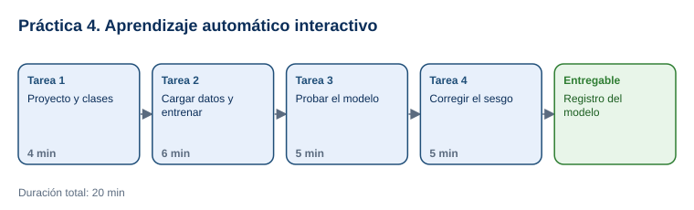

# Práctica 4. Aprendizaje automático interactivo

**Taller práctico: Aplicación de la Inteligencia Artificial Moderna · Práctica 4 de 7**

⏱️ **Duración:** 20 min · 🛠️ **Herramienta:** [Teachable Machine (Google)](https://teachablemachine.withgoogle.com/) · 📄 **Entregable:** `Registro_Teachable_Machine_[INICIALES].xlsx`

## Descripción

Un modelo de aprendizaje automático aprende de los ejemplos que recibe, y también de sus errores. En esta práctica el participante entrenará en Teachable Machine un clasificador de imágenes de tres figuras (círculo, cuadrado y triángulo), lo probará con imágenes que no vio y después entrenará una versión con datos sesgados para observar cómo el modelo aprende el color en lugar de la forma. Así comprenderá por qué la calidad de los datos determina la calidad del modelo.

## Objetivos de aprendizaje

Al finalizar la práctica, el participante será capaz de:

- Crear y entrenar un modelo de clasificación de imágenes sin programar.
- Evaluar el modelo con imágenes de prueba y calcular su exactitud.
- Identificar el efecto de datos sesgados y corregirlo mejorando el conjunto de entrenamiento.

## Antes de empezar

| Elemento | Valor |
|---|---|
| Dónde trabajar | Navegador web: [teachablemachine.withgoogle.com](https://teachablemachine.withgoogle.com/) |
| Archivos de la práctica | [Dataset_Figuras.zip](recursos/Dataset_Figuras.zip) y [Registro_Teachable_Machine.xlsx](recursos/Registro_Teachable_Machine.xlsx) |
| Contenido del dataset | `entrenamiento/` (15 imágenes por clase), `prueba/` (5 por clase), `sesgo_entrenamiento/` (cada figura de un solo color) y `sesgo_prueba/` (3 imágenes con colores cambiados) |
| Carpeta de trabajo | `Documentos\Taller_IA_Moderna\Practica04\` |
| Nombre del entregable | `Registro_Teachable_Machine_[INICIALES].xlsx` |

> **Para descargar el dataset:** abrir [Dataset_Figuras.zip](recursos/Dataset_Figuras.zip), seleccionar **Download raw file** y descomprimirlo en la carpeta de trabajo (clic derecho > **Extraer todo**). Se crea la carpeta `dataset` con 108 imágenes. Teachable Machine procesa las imágenes en el navegador; no se suben a un servidor.

---

## Tarea 1. Proyecto y clases (4 min)

**Objetivo:** Tener un proyecto de imágenes con 3 clases.

**Por qué:** Cada clase es una categoría que el modelo debe aprender a distinguir.

**Paso 1.** Guardar el registro como `Registro_Teachable_Machine_[INICIALES].xlsx`.

**Paso 2.** Abrir [Teachable Machine](https://teachablemachine.withgoogle.com/), seleccionar **Get Started** > **Image Project** > **Standard image model**.

**Paso 3.** Cambiar el nombre de **Class 1** a `Circulo` y de **Class 2** a `Cuadrado`. Seleccionar **Add a class** y nombrarla `Triangulo`.

**Al terminar esta tarea debes tener:**

- ✔ Un proyecto con las clases `Circulo`, `Cuadrado` y `Triangulo`.

---

## Tarea 2. Cargar datos y entrenar (6 min)

**Objetivo:** Entrenar el modelo con 45 imágenes.

**Por qué:** El modelo solo puede aprender de los ejemplos que se le dan.

**Paso 1.** En la clase `Circulo`, seleccionar **Upload** > **Choose images from your files**, ir a `dataset\entrenamiento\Circulo`, seleccionar las 15 imágenes y abrirlas.

**Paso 2.** Repetir para `Cuadrado` y `Triangulo` con sus carpetas.

**Paso 3.** Seleccionar **Train Model** y esperar a que termine (de 30 a 60 segundos). No cambiar de pestaña mientras entrena.

- **Qué verás:** el panel **Preview** con la opción de cargar una imagen y barras de confianza por clase.

**Al terminar esta tarea debes tener:**

- ✔ El modelo entrenado.

---

## Tarea 3. Probar el modelo (5 min)

**Objetivo:** Completar la hoja `Pruebas` con las 15 imágenes de prueba.

**Por qué:** La exactitud se mide con imágenes que el modelo no vio durante el entrenamiento.

**Paso 1.** En **Preview**, cambiar **Input** de **Webcam** a **File** y cargar `prueba\Circulo\circulo_01.png`.

**Paso 2.** Anotar la clase predicha, la confianza y si es correcta.

**Paso 3.** Repetir con las 15 imágenes de prueba.

- **Qué verás:** la celda de exactitud calcula aciertos sobre 15. Con este dataset se espera una exactitud alta (13 a 15 aciertos).

**Al terminar esta tarea debes tener:**

- ✔ 15 pruebas registradas y la exactitud calculada.

---

## Tarea 4. Corregir el sesgo (5 min)

**Objetivo:** Completar la hoja `Sesgo` y las conclusiones.

**Por qué:** Si los datos tienen un patrón accidental (como el color), el modelo lo aprende en lugar del concepto correcto.

**Paso 1.** Abrir una pestaña nueva de Teachable Machine, crear otro proyecto con las mismas 3 clases y cargar las imágenes de `sesgo_entrenamiento` (todos los círculos rojos, cuadrados azules y triángulos verdes). Entrenar.

**Paso 2.** Probar con las 3 imágenes de `sesgo_prueba` (círculo azul, cuadrado verde y triángulo rojo) y anotar las predicciones.

- **Qué verás:** el modelo suele clasificar por color: por ejemplo, el círculo azul como `Cuadrado`.

**Paso 3.** Probar las mismas 3 imágenes en el primer modelo (entrenado con colores variados) y anotar las predicciones como **modelo corregido**.

**Paso 4.** Responder las preguntas de la hoja `Conclusiones` y guardar el archivo.

**Al terminar esta tarea debes tener:**

- ✔ La comparación entre modelo sesgado y corregido, y las conclusiones escritas.

---

## Validación y pruebas

| Caso | Acción | Resultado esperado |
|---|---|---|
| Exactitud | Revisar la celda de exactitud | 87% o más (13 de 15 o mejor) |
| Sesgo | Probar `circulo_azul.png` en el modelo sesgado | Predicción incorrecta o confianza baja en `Circulo` |
| Caso adversarial | Cargar en **Preview** una imagen que no sea ninguna figura (por ejemplo, la foto de la Práctica 3) | El modelo igual asigna una de las 3 clases: no sabe decir "ninguna" si no se le entrenó |

## Entregables

| Entregable | Contenido | Criterio de verificación |
|---|---|---|
| `Registro_Teachable_Machine_[INICIALES].xlsx` | Hojas `Pruebas`, `Sesgo` y `Conclusiones` | 15 pruebas con exactitud; 3 pruebas de sesgo en ambos modelos; 3 conclusiones |

## Resultado esperado

- El participante entrena y evalúa un modelo de clasificación con datos propios.
- Explica cómo los datos de entrenamiento determinan lo que el modelo aprende y cómo corregir un sesgo.

## Solución de problemas

**El entrenamiento no inicia o se congela**
- *Síntoma:* la barra de progreso no avanza.
- *Causa:* la pestaña quedó en segundo plano o el navegador tiene poca memoria.
- *Solución:* mantener la pestaña visible, cerrar otras pestañas y volver a entrenar.

**No se pueden seleccionar varias imágenes**
- *Síntoma:* solo se carga una imagen.
- *Causa:* selección individual.
- *Solución:* en la ventana de archivos, usar **Ctrl+A** para seleccionar las 15 imágenes de la carpeta.

## Limpieza

- Conservar el entregable en `Documentos\Taller_IA_Moderna\Practica04\`.
- Los proyectos de Teachable Machine se pierden al cerrar la pestaña; no es necesario eliminarlos.

## Recursos opcionales

- [Teachable Machine: preguntas frecuentes](https://teachablemachine.withgoogle.com/faq)

Complejidad: Fácil · Nivel de Bloom: Aplicar

---

[⬅ Anterior: Práctica 3](../Capitulo03/README.md) | [Inicio](../README.md) | [Siguiente: Práctica 5 ➡](../Capitulo05/README.md)
