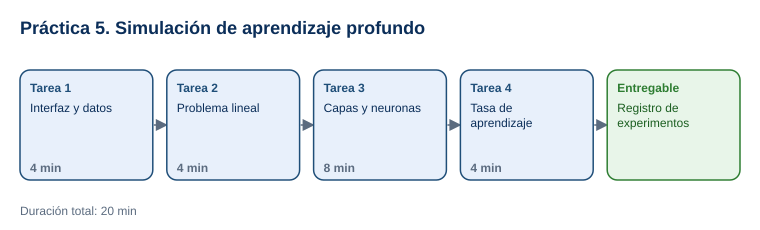

# Práctica 5. Simulación de aprendizaje profundo

**Taller práctico: Aplicación de la Inteligencia Artificial Moderna · Práctica 5 de 7**

⏱️ **Duración:** 20 min · 🛠️ **Herramienta:** [TensorFlow Playground](https://playground.tensorflow.org/) · 📄 **Entregable:** `Registro_TensorFlow_Playground_[INICIALES].xlsx`

## Descripción

El aprendizaje profundo usa redes neuronales con varias capas. TensorFlow Playground permite ver una red neuronal aprender en tiempo real, sin programar. En esta práctica el participante resolverá problemas de clasificación de dificultad creciente (dos grupos, un círculo y una espiral), agregará capas y neuronas, cambiará la tasa de aprendizaje y registrará cómo cada cambio afecta la pérdida (*loss*) y la capacidad del modelo para separar las clases.

## Objetivos de aprendizaje

Al finalizar la práctica, el participante será capaz de:

- Identificar los componentes de una red neuronal: entradas, capas ocultas, neuronas, pesos y salida.
- Explicar por qué los problemas no lineales requieren capas ocultas o características adicionales.
- Analizar el efecto de la tasa de aprendizaje en el entrenamiento a partir de la pérdida de prueba.

## Antes de empezar

| Elemento | Valor |
|---|---|
| Dónde trabajar | Navegador web: [playground.tensorflow.org](https://playground.tensorflow.org/) |
| Archivos de la práctica | [Registro_TensorFlow_Playground.xlsx](recursos/Registro_TensorFlow_Playground.xlsx) |
| Carpeta de trabajo | `Documentos\Taller_IA_Moderna\Practica05\` |
| Dato clave | **Test loss** cercana a 0 = el modelo clasifica bien datos que no vio; por encima de 0.4 = clasifica mal |
| Nombre del entregable | `Registro_TensorFlow_Playground_[INICIALES].xlsx` |

> Los resultados exactos varían en cada ejecución porque los pesos iniciales son aleatorios. Se registran los valores observados.

---

## Tarea 1. Interfaz y datos (4 min)

**Objetivo:** Ubicar los controles que se usarán.

**Por qué:** Cada experimento cambia uno de estos controles.

**Paso 1.** Guardar el registro como `Registro_TensorFlow_Playground_[INICIALES].xlsx` y abrir [TensorFlow Playground](https://playground.tensorflow.org/).

**Paso 2.** Ubicar con el instructor:
   - **DATA:** los 4 conjuntos de datos (Circle, Exclusive or, Gaussian, Spiral).
   - **FEATURES:** las entradas (x1, x2, x1², x2², sin(x1), sin(x2) y otras).
   - **HIDDEN LAYERS:** botones **+** y **−** para capas y neuronas.
   - Barra superior: **Play/Pause**, **Epoch**, **Learning rate** y **Activation**.
   - **OUTPUT:** **Test loss** y **Training loss**.

**Al terminar esta tarea debes tener:**

- ✔ Identificados los 5 grupos de controles.

---

## Tarea 2. Problema lineal (4 min)

**Objetivo:** Registrar E1 y E2.

**Por qué:** Muestra qué puede resolver una red sin capas ocultas y qué no.

**Paso 1.** Configurar **E1**: dataset **Gaussian**, solo x1 y x2, 0 capas ocultas (quitar capas con **−**), learning rate `0.03`, activación `Tanh`. Seleccionar **Play** y detener cuando la pérdida se estabilice (unas 200 épocas).

- **Qué verás:** una línea recta separa los dos grupos; **Test loss** cercana a 0.

**Paso 2.** Registrar épocas, test loss y si separa bien las clases.

**Paso 3.** Configurar **E2**: igual que E1, pero dataset **Circle**. Seleccionar **Play** durante unas 300 épocas.

- **Qué verás:** el modelo no logra separar el círculo con una línea recta; la pérdida se mantiene alta.

**Al terminar esta tarea debes tener:**

- ✔ E1 y E2 registrados.

---

## Tarea 3. Capas y neuronas (8 min)

**Objetivo:** Registrar E3, E4 y E5.

**Por qué:** Las capas ocultas permiten aprender fronteras curvas; los problemas más complejos necesitan más capacidad.

**Paso 1.** **E3**: dataset **Circle**, x1 y x2, 1 capa oculta con 4 neuronas. Seleccionar **Play** unas 300 épocas.

- **Qué verás:** la frontera se curva y rodea el círculo; la pérdida baja.

**Paso 2.** **E4**: misma red, dataset **Spiral**. Seleccionar **Play** unas 500 épocas.

- **Qué verás:** la red no logra seguir la espiral.

**Paso 3.** **E5**: dataset **Spiral**, activar las 6 características de la tabla (x1, x2, x1², x2², sin(x1), sin(x2)) y usar 3 capas con 8, 8 y 4 neuronas. Seleccionar **Play** hasta 1,000 épocas como máximo.

- **Qué verás:** la frontera empieza a seguir la espiral y la pérdida baja de forma notable.

**Paso 4.** Registrar los 3 experimentos y observar los pesos: las líneas más gruesas son conexiones con más influencia.

**Al terminar esta tarea debes tener:**

- ✔ E3, E4 y E5 registrados con su observación.

---

## Tarea 4. Tasa de aprendizaje (4 min)

**Objetivo:** Registrar E6 y E7 y guardar el entregable.

**Por qué:** La tasa de aprendizaje controla el tamaño de cada ajuste de los pesos; si es muy alta o muy baja, el modelo no aprende bien.

**Paso 1.** **E6**: configuración de E3 con learning rate `3`. Seleccionar **Play** 300 épocas.

- **Qué verás:** la pérdida oscila o no baja: los ajustes son demasiado grandes.

**Paso 2.** **E7**: configuración de E3 con learning rate `0.0001`. Seleccionar **Play** 300 épocas.

- **Qué verás:** la pérdida casi no cambia: los ajustes son demasiado pequeños.

**Paso 3.** Registrar ambos, escribir debajo de la tabla una conclusión de 2 líneas y guardar el archivo.

**Al terminar esta tarea debes tener:**

- ✔ Los 7 experimentos registrados y la conclusión escrita.

---

## Validación y pruebas

| Caso | Configuración | Resultado esperado |
|---|---|---|
| Lineal | E1 (Gaussian, 0 capas) | Separa bien; test loss baja |
| No lineal | E2 frente a E3 (Circle sin y con capa oculta) | E3 tiene una pérdida mucho menor que E2 |
| Tasa alta | E6 (learning rate 3) | La pérdida oscila o no converge |
| Caso adversarial | Pregunta del instructor: *"¿Más capas siempre mejoran el modelo?"* | No: más capas sin datos o configuración adecuados pueden entrenar más lento o sobreajustarse; se elige la capacidad según el problema |

## Entregables

| Entregable | Contenido | Criterio de verificación |
|---|---|---|
| `Registro_TensorFlow_Playground_[INICIALES].xlsx` | Hoja `Experimentos` y conclusión | 7 experimentos con épocas, test loss, separación y observación; conclusión sobre capas y tasa de aprendizaje |

## Resultado esperado

- El participante explica de forma práctica cómo las capas, las neuronas, las características y la tasa de aprendizaje afectan el aprendizaje de una red neuronal.

## Solución de problemas

**La pérdida aparece como NaN**
- *Síntoma:* la pérdida muestra `NaN` y la visualización desaparece.
- *Causa:* tasa de aprendizaje demasiado alta.
- *Solución:* es un resultado válido para E6; registrarlo y seleccionar el botón de reinicio (flecha circular) antes del siguiente experimento.

**Los resultados no se parecen a los de un compañero**
- *Síntoma:* pérdidas distintas con la misma configuración.
- *Causa:* pesos iniciales aleatorios.
- *Solución:* comparar tendencias, no valores exactos; reiniciar y repetir si es necesario.

## Limpieza

- Conservar el entregable en `Documentos\Taller_IA_Moderna\Practica05\`.

## Recursos opcionales

- [Google: introducción a las redes neuronales](https://developers.google.com/machine-learning/crash-course/neural-networks)

Complejidad: Intermedia · Nivel de Bloom: Analizar

---

[⬅ Anterior: Práctica 4](../Capitulo04/README.md) | [Inicio](../README.md) | [Siguiente: Práctica 6 ➡](../Capitulo06/README.md)
