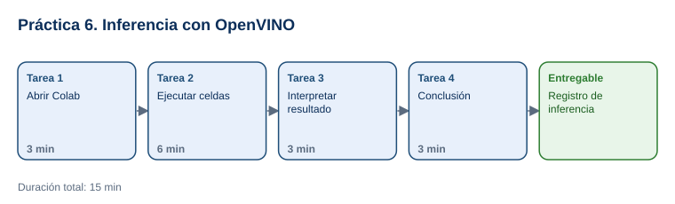

# Práctica 6. OpenVINO Toolkit

**Taller práctico: Aplicación de la Inteligencia Artificial Moderna · Práctica 6 de 7**

⏱️ **Duración:** 15 min · 🛠️ **Herramienta:** OpenVINO Notebooks en Google Colab · 📄 **Entregable:** `Registro_OpenVINO_[INICIALES].docx`

## Descripción

Entrenar un modelo es solo una parte; después hay que ejecutarlo (inferencia) de forma rápida en el equipo donde se usará. OpenVINO es un kit de herramientas de Intel que optimiza y ejecuta modelos de IA en CPU, GPU y otros dispositivos. En esta práctica el participante ejecutará en Google Colab, sin instalar nada, el notebook oficial **Hello Image Classification**: un modelo de visión (MobileNetV3) clasificará una imagen y el participante interpretará el resultado.

## Objetivos de aprendizaje

Al finalizar la práctica, el participante será capaz de:

- Explicar qué es OpenVINO y qué significa ejecutar inferencia con un modelo optimizado.
- Ejecutar un notebook guiado en Google Colab y reconocer sus etapas: instalación, carga del modelo, carga de la imagen e inferencia.
- Interpretar el resultado de la clasificación y relacionarlo con casos de uso reales.

## Antes de empezar

| Elemento | Valor |
|---|---|
| Dónde trabajar | [Notebook Hello Image Classification en Google Colab](https://colab.research.google.com/github/openvinotoolkit/openvino_notebooks/blob/latest/notebooks/hello-world/hello-world.ipynb) |
| Cuenta requerida | Cuenta de Google |
| Archivos de la práctica | [Registro_OpenVINO.docx](recursos/Registro_OpenVINO.docx) |
| Carpeta de trabajo | `Documentos\Taller_IA_Moderna\Practica06\` |
| Nombre del entregable | `Registro_OpenVINO_[INICIALES].docx` |

> No se necesita saber programar: el notebook ya tiene el código. Solo se ejecutan las celdas en orden y se leen los resultados.

---

## Tarea 1. Abrir el notebook en Colab (3 min)

**Objetivo:** Tener el notebook abierto y conectado a un entorno de ejecución.

**Por qué:** Colab ejecuta el código en un servidor de Google; por eso no hay que instalar nada.

**Paso 1.** Guardar el registro como `Registro_OpenVINO_[INICIALES].docx`.

**Paso 2.** Abrir el [notebook en Google Colab](https://colab.research.google.com/github/openvinotoolkit/openvino_notebooks/blob/latest/notebooks/hello-world/hello-world.ipynb) e iniciar sesión con la cuenta de Google.

**Paso 3.** Seleccionar **Conectar** (arriba a la derecha).

- **Qué verás:** indicadores de RAM y disco cuando el entorno esté conectado.

**Al terminar esta tarea debes tener:**

- ✔ El notebook abierto y conectado.

---

## Tarea 2. Ejecutar las celdas (6 min)

**Objetivo:** Ejecutar el notebook completo sin errores.

**Por qué:** Cada celda corresponde a una etapa de la inferencia.

**Paso 1.** Seleccionar **Entorno de ejecución > Ejecutar todas** (**Runtime > Run all**).

- **Si aparece "Advertencia: Este notebook no lo creó Google":** seleccionar **Ejecutar de todos modos**; es el repositorio oficial de OpenVINO.

**Paso 2.** Esperar a que termine la celda de instalación (`%pip install ... openvino ...`); tarda de 1 a 2 minutos. Anotar en la plantilla la versión de OpenVINO que muestra la salida.

**Paso 3.** Bajar por el notebook y ubicar las etapas:
   - **Download the Model and data samples:** descarga el modelo MobileNetV3 en formato OpenVINO (archivos `.xml` y `.bin`).
   - **Select inference device:** dispositivo de inferencia (en Colab, `CPU` o `AUTO`).
   - **Load the Model:** carga y compila el modelo.
   - **Load an Image:** descarga y muestra la imagen de ejemplo.
   - **Do Inference:** ejecuta el modelo y obtiene la clase con mayor probabilidad.

**Paso 4.** Anotar el dispositivo, el modelo y el tamaño de entrada (224 × 224).

**Al terminar esta tarea debes tener:**

- ✔ Todas las celdas ejecutadas con una marca verde.

---

## Tarea 3. Interpretar el resultado (3 min)

**Objetivo:** Registrar la clase predicha y evaluar si es correcta.

**Por qué:** Un modelo de clasificación solo conoce las clases con las que se entrenó (1,000 clases de ImageNet).

**Paso 1.** Ubicar la salida de la última celda: el nombre de la clase predicha para la imagen de ejemplo.

**Paso 2.** Comparar con la imagen mostrada en **Load an Image** y anotar si coincide.

**Paso 3 (opcional).** Para probar otra imagen, ir a **Load an Image**, sustituir en la línea de descarga la URL de la imagen por la URL pública de una foto de un perro, un gato o un objeto común, cambiar `coco.jpg` por otro nombre de archivo y ejecutar desde esa celda hasta el final. Anotar la nueva predicción.

**Al terminar esta tarea debes tener:**

- ✔ La clase predicha registrada y evaluada.

---

## Tarea 4. Conclusión (3 min)

**Objetivo:** Completar la sección **3. Interpretación** y guardar el entregable.

**Por qué:** El valor de OpenVINO está en ejecutar modelos de forma eficiente cerca de donde se generan los datos (en el borde).

**Paso 1.** Responder qué hace OpenVINO en el flujo (optimiza y ejecuta el modelo en el hardware disponible) y un caso de uso en su trabajo (por ejemplo, inspección visual en una línea de producción con una cámara y un equipo local).

**Paso 2.** Guardar el documento.

**Al terminar esta tarea debes tener:**

- ✔ La plantilla completa y guardada.

---

## Validación y pruebas

| Caso | Acción | Resultado esperado |
|---|---|---|
| Instalación | Revisar la salida de la celda de `pip install` | Instalación sin errores |
| Inferencia | Revisar la última celda | Una clase de ImageNet que corresponde a la imagen de ejemplo |
| Caso adversarial | Pregunta del instructor: *"Si le doy una radiografía, ¿la clasificará correctamente?"* | No: el modelo solo conoce las clases de ImageNet; para otro dominio se necesita otro modelo |

## Entregables

| Entregable | Contenido | Criterio de verificación |
|---|---|---|
| `Registro_OpenVINO_[INICIALES].docx` | Ejecución, resultado e interpretación | Versión de OpenVINO, dispositivo y modelo; clase predicha y evaluación; caso de uso propio |

## Resultado esperado

- El participante ejecuta una inferencia guiada con OpenVINO sin instalación local y explica su resultado y su utilidad.

## Solución de problemas

**Error en la celda de instalación**
- *Síntoma:* mensajes en rojo durante `pip install`.
- *Causa:* conflicto temporal de paquetes en el entorno de Colab.
- *Solución:* seleccionar **Entorno de ejecución > Reiniciar sesión** y volver a ejecutar todas las celdas.

**Colab no se conecta**
- *Síntoma:* el botón **Conectar** no cambia.
- *Causa:* límite de uso de la cuenta gratuita o red bloqueada.
- *Solución:* esperar unos minutos, usar otra cuenta de Google o seguir la ejecución que proyecte el instructor.

## Limpieza

- Seleccionar **Entorno de ejecución > Desconectar y borrar entorno de ejecución**.
- No es necesario guardar una copia del notebook en Drive.

## Recursos opcionales

- [OpenVINO Notebooks en GitHub](https://github.com/openvinotoolkit/openvino_notebooks)

Complejidad: Fácil · Nivel de Bloom: Comprender

---

[⬅ Anterior: Práctica 5](../Capitulo05/README.md) | [Inicio](../README.md) | [Siguiente: Práctica 7 ➡](../Capitulo07/README.md)
