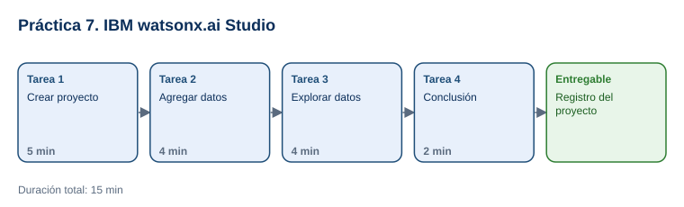

# Práctica 7. IBM Watson Studio

**Taller práctico: Aplicación de la Inteligencia Artificial Moderna · Práctica 7 de 7**

⏱️ **Duración:** 15 min · 🛠️ **Herramienta:** IBM watsonx.ai Studio (plan Lite) · 📄 **Entregable:** `Registro_watsonx_[INICIALES].docx`

## Descripción

Las plataformas empresariales de IA organizan el trabajo en proyectos donde se reúnen datos, notebooks y modelos. En esta práctica el participante accederá a IBM watsonx.ai Studio (antes Watson Studio), creará un proyecto básico, agregará un archivo de incidencias de operación y lo explorará sin programar, con la vista previa, el perfil de datos y las visualizaciones. Así integrará el uso de una plataforma de IA en el flujo de análisis para la toma de decisiones.

## Objetivos de aprendizaje

Al finalizar la práctica, el participante será capaz de:

- Navegar la interfaz de IBM watsonx.ai Studio y crear un proyecto.
- Agregar un conjunto de datos a un proyecto como activo de datos.
- Explorar los datos con la vista previa, el perfil y las visualizaciones para responder preguntas de negocio.

## Antes de empezar

| Elemento | Valor |
|---|---|
| Dónde trabajar | [IBM watsonx (dataplatform.cloud.ibm.com)](https://dataplatform.cloud.ibm.com/) con la cuenta de IBM Cloud |
| Requisito previo | Cuenta de IBM Cloud con el servicio watsonx.ai Studio (plan Lite) habilitado antes del taller (ver [Setup_Guide.md](../Setup_Guide.md)) |
| Archivos de la práctica | [Incidencias_Operacion.csv](recursos/Incidencias_Operacion.csv), [Registro_watsonx.docx](recursos/Registro_watsonx.docx) |
| Carpeta de trabajo | `Documentos\Taller_IA_Moderna\Practica07\` |
| Nombre del entregable | `Registro_watsonx_[INICIALES].docx` |

> El archivo tiene 120 incidencias ficticias (agosto a octubre de 2026) con área, tipo, prioridad, horas para resolver, costo y estado.

---

## Tarea 1. Crear el proyecto (5 min)

**Objetivo:** Tener un proyecto vacío con almacenamiento asociado.

**Por qué:** El proyecto es el espacio donde se guardan los datos y los recursos de análisis.

**Paso 1.** Guardar el registro como `Registro_watsonx_[INICIALES].docx` y descargar el CSV.

**Paso 2.** Abrir [dataplatform.cloud.ibm.com](https://dataplatform.cloud.ibm.com/) e iniciar sesión con su IBMid. Si se solicita, elegir la región indicada por el instructor.

- **Qué verás:** la página de inicio de watsonx con accesos a proyectos y servicios.

**Paso 3.** Seleccionar **Create a project** (o **Projects > New project**) y elegir **Create an empty project**.

**Paso 4.** Escribir el nombre `Taller_IA_[INICIALES]`. En **Storage**, seleccionar la instancia de **Cloud Object Storage** existente (o **Add** para crear una Lite) y seleccionar **Create**.

- **Si no ocurre así:** si no hay almacenamiento disponible, avisar al instructor; la cuenta debe tener Cloud Object Storage Lite.

**Paso 5.** Anotar en la plantilla el nombre del proyecto, el almacenamiento y la región.

**Al terminar esta tarea debes tener:**

- ✔ El proyecto creado y abierto.

---

## Tarea 2. Agregar los datos (4 min)

**Objetivo:** Tener `Incidencias_Operacion.csv` como activo de datos del proyecto.

**Por qué:** Los datos deben estar dentro del proyecto para explorarlos y, después, construir modelos.

**Paso 1.** En el proyecto, abrir la pestaña **Assets** y seleccionar el icono de carga de datos (**Upload asset to project** o el panel **Data**, arriba a la derecha).

**Paso 2.** Arrastrar `Incidencias_Operacion.csv` al panel o seleccionar **Drop data files here or browse for files to upload**.

- **Qué verás:** el archivo en la lista de activos cuando termine la carga.

**Al terminar esta tarea debes tener:**

- ✔ El activo de datos en la pestaña **Assets**.

---

## Tarea 3. Explorar los datos (4 min)

**Objetivo:** Completar la sección **2. Datos** de la plantilla.

**Por qué:** Explorar los datos es el primer paso para decidir qué preguntas pueden responderse con IA.

**Paso 1.** Seleccionar el activo `Incidencias_Operacion.csv`.

- **Qué verás:** la pestaña **Preview** con las columnas y filas del archivo.

**Paso 2.** Anotar el número de filas (120) y columnas (8).

**Paso 3.** Abrir la pestaña **Profile** y seleccionar **Create profile** si se solicita. Revisar la distribución de valores de las columnas `Area` y `Tipo`.

**Paso 4.** Abrir la pestaña **Visualization**, elegir un gráfico de barras con la columna `Area` y anotar el área con más incidencias. Repetir con `Tipo`.

**Al terminar esta tarea debes tener:**

- ✔ La sección 2 completa con datos observados en la plataforma.

---

## Tarea 4. Conclusión (2 min)

**Objetivo:** Completar la sección **3. Conclusión** y guardar el entregable.

**Por qué:** Conectar la exploración con una decisión de negocio cierra el ciclo de análisis.

**Paso 1.** Escribir una pregunta de negocio que podría responder un modelo con estos datos (por ejemplo, estimar las horas de resolución según área, tipo y prioridad) y qué herramienta de watsonx.ai Studio usaría después (por ejemplo, AutoAI para entrenar un modelo sin programar).

**Paso 2.** Guardar el documento.

**Al terminar esta tarea debes tener:**

- ✔ La plantilla completa y guardada.

---

## Validación y pruebas

| Caso | Acción | Resultado esperado |
|---|---|---|
| Proyecto | Revisar **Projects** | El proyecto `Taller_IA_[INICIALES]` aparece en la lista |
| Datos | Revisar **Preview** | 120 filas y 8 columnas |
| Visualización | Gráfico de barras por `Area` y por `Tipo` | Almacén es el área con más incidencias (27); "Falta de material" es el tipo más frecuente (35) |
| Caso adversarial | Pregunta del instructor: *"¿Podemos subir la base real de incidencias de la empresa a este proyecto?"* | Solo con autorización y en una cuenta institucional con las políticas de datos aprobadas; en el taller se usan datos ficticios |

## Entregables

| Entregable | Contenido | Criterio de verificación |
|---|---|---|
| `Registro_watsonx_[INICIALES].docx` | Proyecto, datos y conclusión | Nombre del proyecto y almacenamiento; filas, columnas, área y tipo más frecuentes; pregunta de negocio y siguiente herramienta |

## Resultado esperado

- El participante crea un proyecto en IBM watsonx.ai Studio, incorpora datos y los explora sin programar para orientar decisiones.

## Solución de problemas

**No se puede crear el proyecto por falta de almacenamiento**
- *Síntoma:* el botón **Create** está deshabilitado.
- *Causa:* no hay una instancia de Cloud Object Storage asociada.
- *Solución:* seleccionar **Add** en **Storage** y crear la instancia Lite, o usar la cuenta preparada por el instructor.

**El servicio pide una tarjeta de crédito o un plan de pago**
- *Síntoma:* el registro no permite continuar.
- *Causa:* las cuentas nuevas de IBM Cloud pueden requerir verificación.
- *Solución:* completar la cuenta antes del taller según la [Setup_Guide.md](../Setup_Guide.md) o trabajar con la demostración del instructor.

## Limpieza

- Opcional: eliminar el proyecto desde **Projects > ... > Delete** para liberar el almacenamiento del plan Lite.

## Recursos opcionales

- [IBM watsonx.ai Studio en el catálogo de IBM Cloud](https://cloud.ibm.com/catalog/services/data-science-experience)

Complejidad: Fácil · Nivel de Bloom: Aplicar

---

[⬅ Anterior: Práctica 6](../Capitulo06/README.md) | [Inicio](../README.md)
